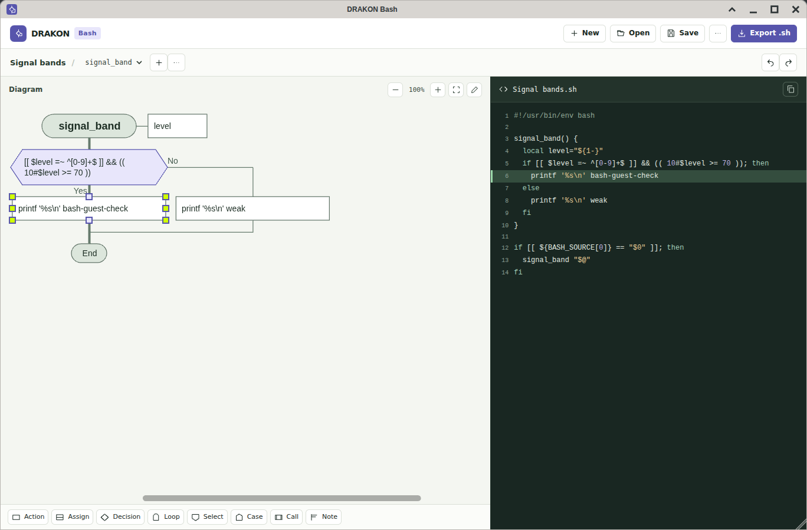

# DRAKON Bash

An independent visual Bash generator for WebOS. Edit an icon to update the source view. Save the diagram as `.drakonsh` and export source as `.sh`. To import a compatible desktop diagram, choose **File options → Import .drn file…**.



Extract this folder to `WebOS/apps/drakon-bash/`. `app.mjs` exports `mount(host)` and `generateSource(project)`. All runtime dependencies ship in this folder.

For WebOS registration, apply the two supplied patches once. An individual app ZIP keeps them in this folder's `integration/` directory. The complete handoff keeps them in its top-level `integration/`. From the WebOS assembly root, set `patch_dir` to the absolute path of that directory before applying the patches.

```sh
git -C platform/desktop apply --check "$patch_dir/desktop.patch"
git apply --check "$patch_dir/webos.patch"
git -C platform/desktop apply "$patch_dir/desktop.patch"
git apply "$patch_dir/webos.patch"
```

Rebuild the viewer as usual. The generator appears under **Programming**.

For a standalone preview, run `python3 -m http.server 8000` inside this folder and open `http://localhost:8000/`. Standalone Save and Export download files. In WebOS, Anon sessions save to temporary Files in the current tab. Signed-in sessions use account Files. Open a saved diagram from Files to continue editing it.

The complete source handoff owns the shared core at `libraries/drakon-core/`. The bundled copy here is generated. See [third-party notices](runtime/NOTICE.md).
