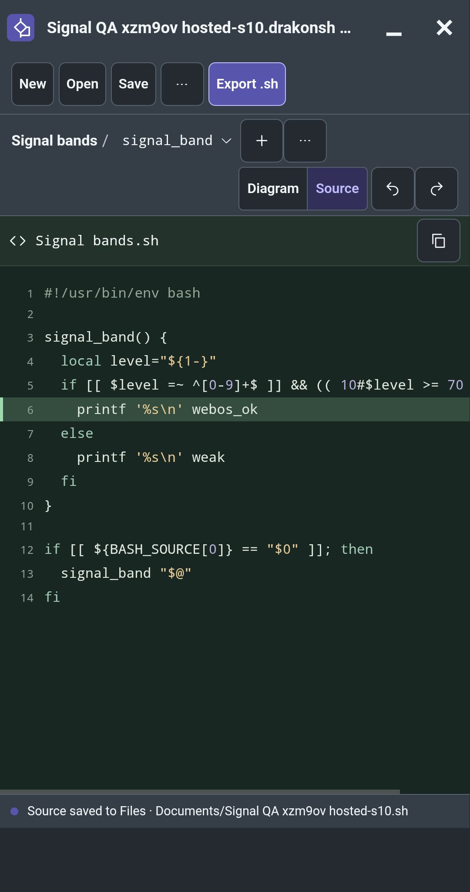
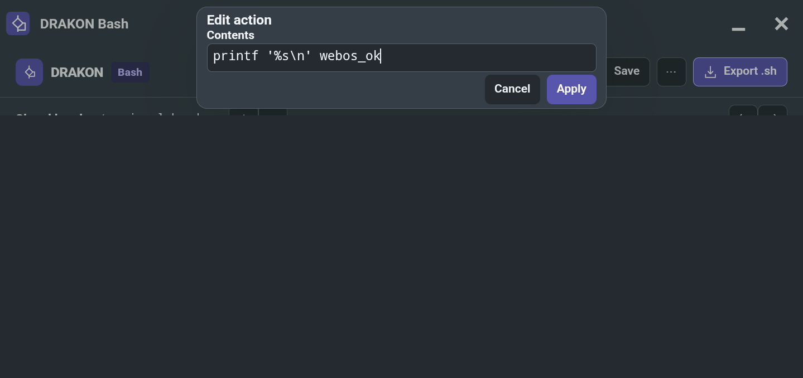
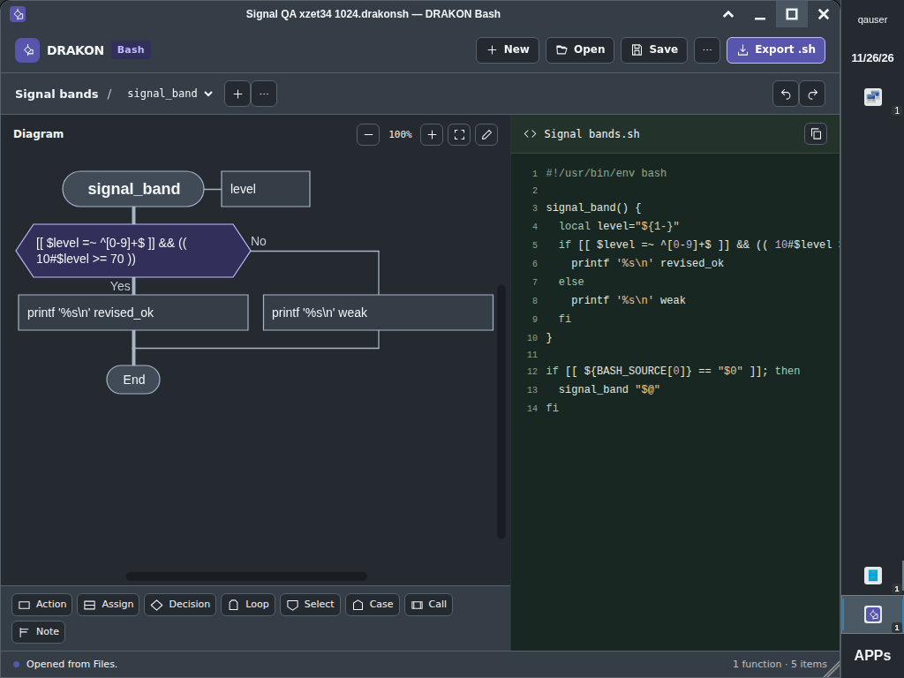

# DRAKON Bash in WebOS

DRAKON Bash opens under **Programming**. On a narrow window, tap **Source** beside **Diagram** to see the generated code. A wider window shows both panes together. The editor now uses the WebOS dark colors and fits its tool and status rows under the window caption. The compact toolbar also fits when My files opens the editor in a 474 CSS-pixel split window on a tablet-sized viewport.

| Tested item | Version |
| --- | --- |
| DRAKON Bash runtime | `cf02726c613ede13b2924a4cb7614a6b1bad277d` |
| WebOS viewer | `c3ac341ebf800563a58f9eb96d564ae43d7380971a11fd6f8af3161148f67288` |
| Galaxy S10+ portrait | Chrome 158.0.8127.92 at 411 CSS pixels wide |
| Moto G 5G landscape | Chrome 158.0.8127.42 at 822 × 331 CSS pixels |
| Tablet touch emulation | Chromium at 1024 × 768 CSS pixels |
| Desktop Chromium | 1300 × 850 CSS pixels |

## Edit and run the example

1. Open the Signal bands example. Tap the `strong` action in Source to select its diagram icon, then tap the edit pencil. In a short landscape window, scroll the source pane to the action before tapping it.
2. Replace the action with `printf '%s\n' webos_ok`. Apply the change and confirm the generated source updates.
3. Tap **Save**, cancel the first folder prompt, then retry. The suggested name ends in `.drakonsh`, and a bare name gains that extension. Use **Export .sh** separately and enter the explicit `.sh` suffix.
4. Open the editable diagram from My files. Guest files are temporary in the current tab. Disposable signed-in sessions reopened account files after a fresh sign-in, saved a later edit to the same diagram, and verified that the earlier export kept its bytes.
5. The test export passed `bash -n`. Running it with input `71` returned `webos_ok`, and input `12` returned `weak`.

The S10+ and Moto kept the edit field and Apply accessible with their software keyboards open. On the Moto that left about 118 CSS pixels of height, and the diagram canvas remains cramped in landscape. Tablet touch emulation verified the side-by-side panes when maximized. Opening the project beside My files kept the toolbar and Source tab reachable by touch.

The portrait baseline covers four of ten workflows: editing a diagram action, tracing source to a diagram item, completing the editable file cycle, and exporting runnable Bash. Desktop covered those four plus zoom and centering, Undo and Redo, adding a function, and importing a DRAKON Editor `.drn` project. Broader diagram construction and the clipboard remain for a later pass.

## Build and release

The WebOS viewer packages the app's `webos-files.json` inventory through `scripts/build_viewer.mjs`. The runtime bundles the shared DRAKON studio, diagram model and compiler. `language.mjs` supplies Bash rules and file extensions. JavaScript and Python bundle their own copies of the studio. The original stylesheet and studio files matched across all three, and the layout patch applies cleanly to both sibling copies.

Both phones repeated the guest workflow over HTTPS. The hosted release verified 21 HTTPS assets. The previous viewer is `ed31e1b4f1c6`. On box-webhost, restore it with `sudo python3 -I -B /var/backups/webos-drakon-bash-portrait-c3ac341ebf80/deploy-viewer.py rollback`.

## Screenshots

**Samsung portrait after exporting Bash to My files.**

**Moto landscape with Apply above the software keyboard.**

**Emulated tablet touch layout after maximizing.**

